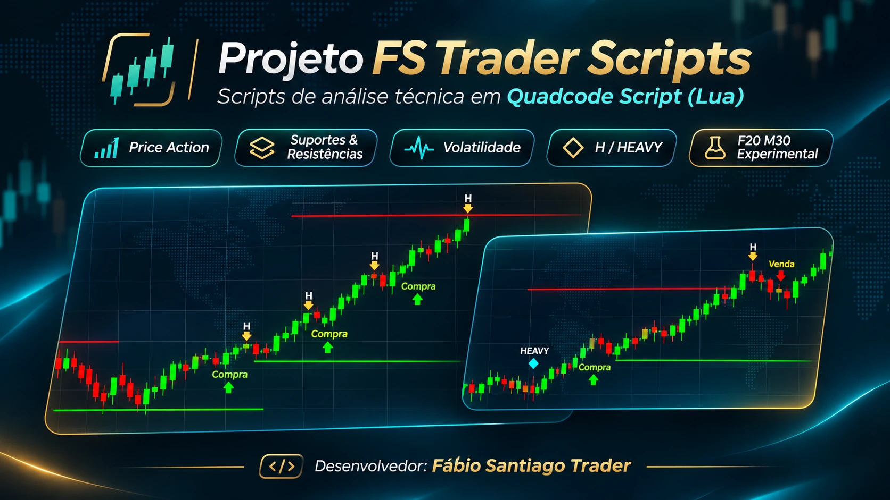
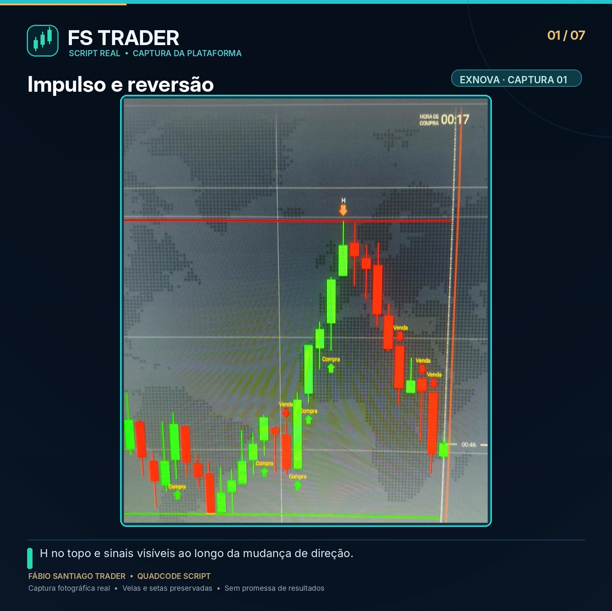
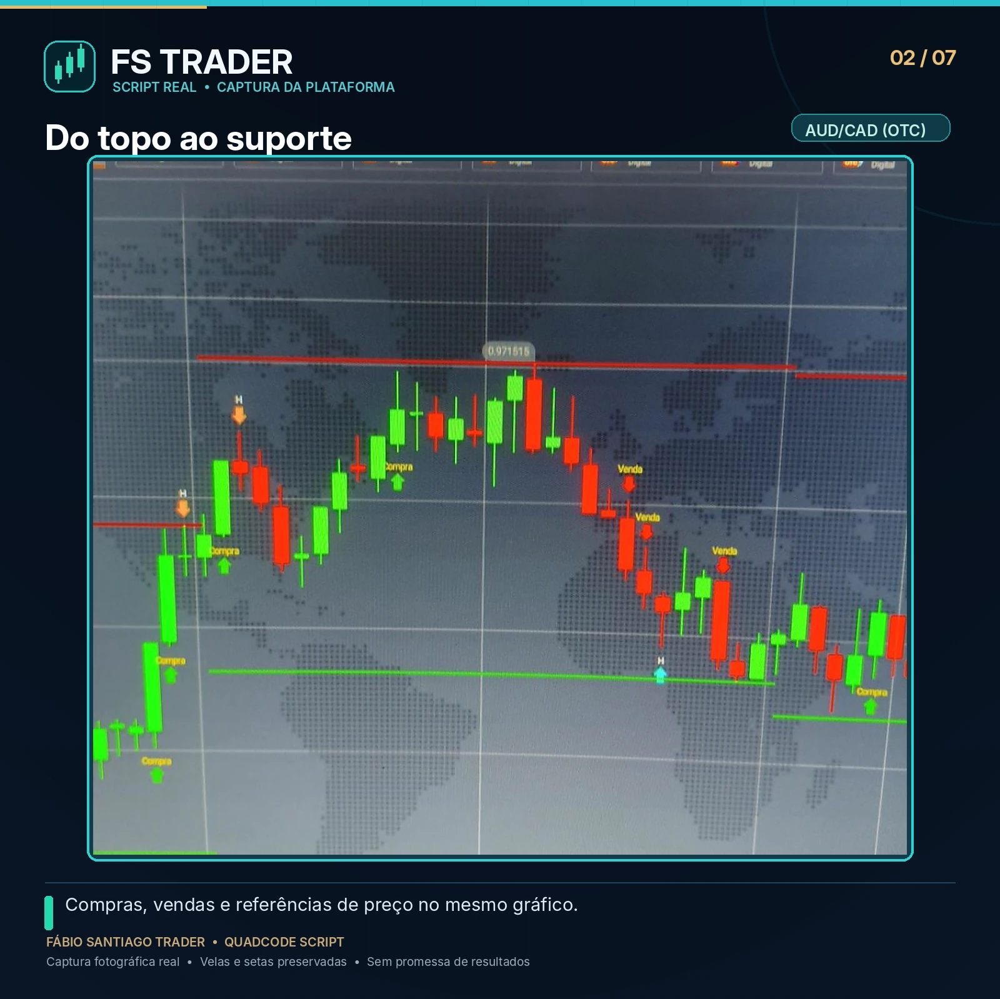
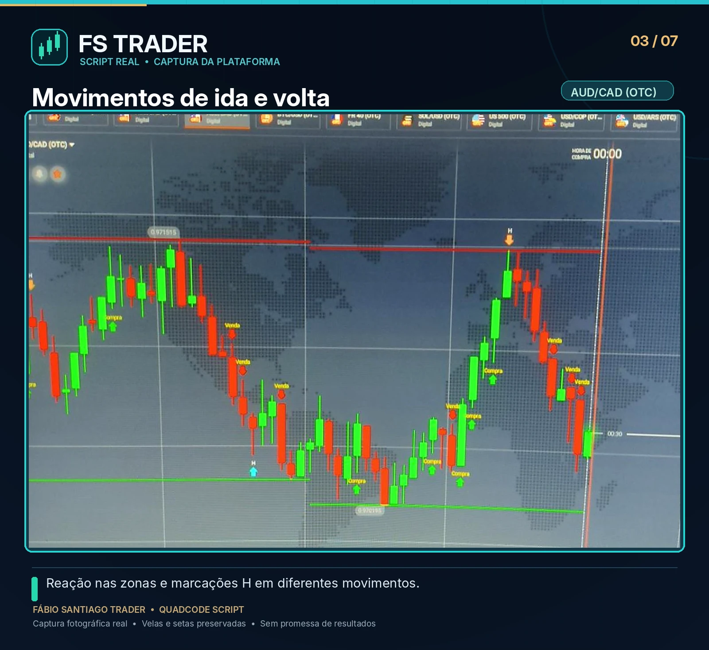
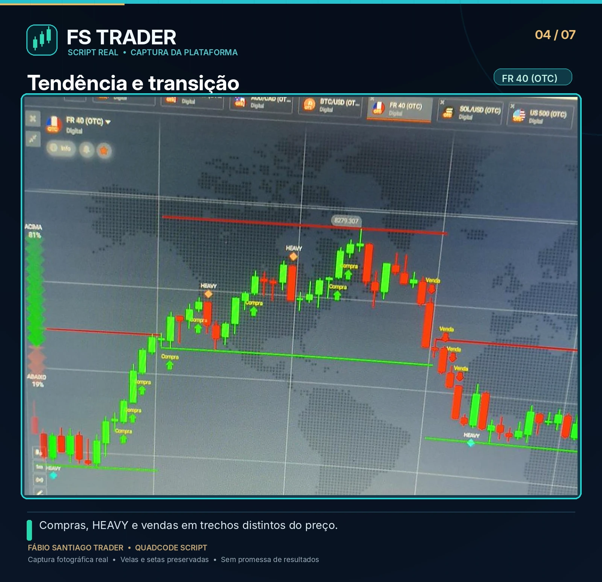
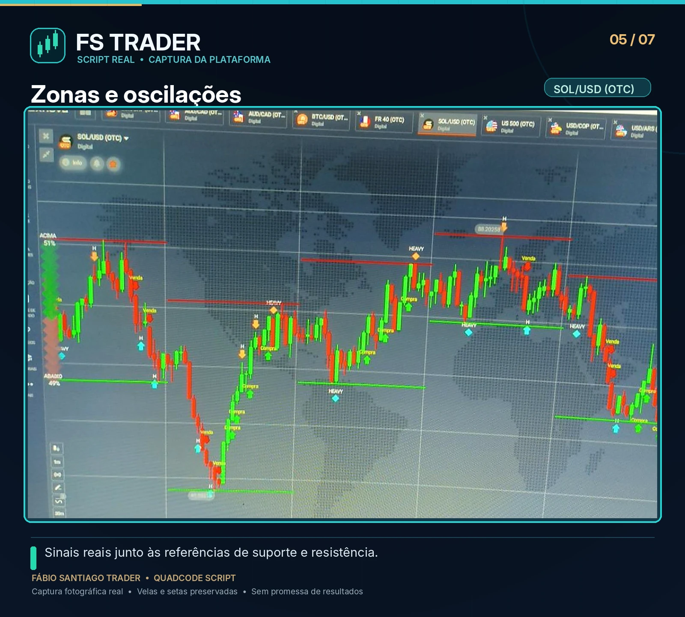
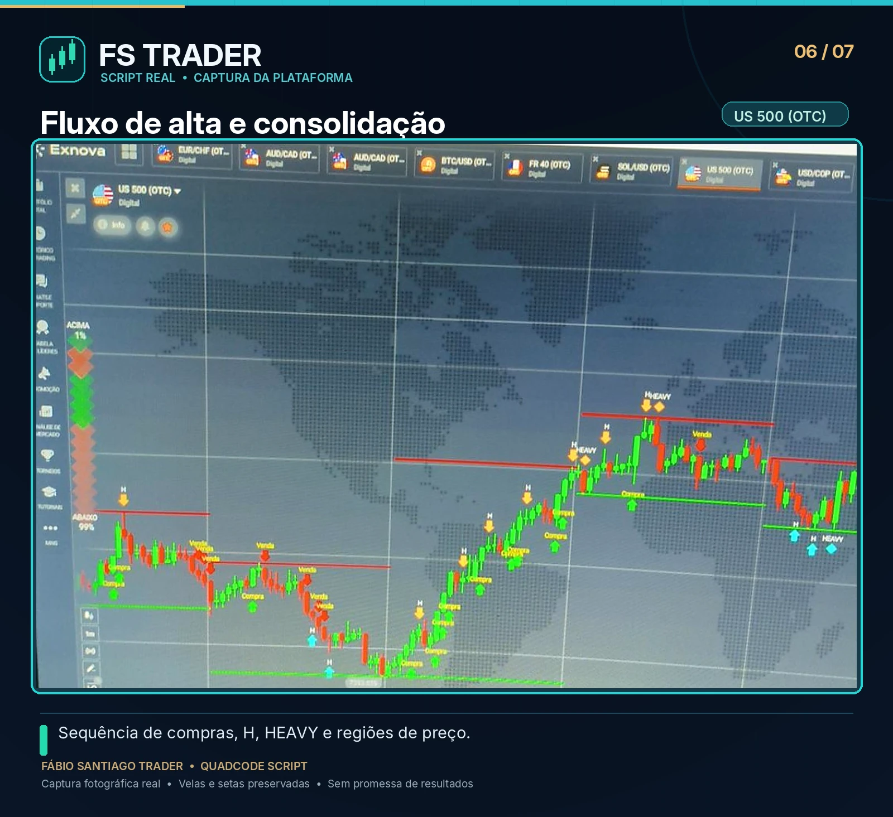
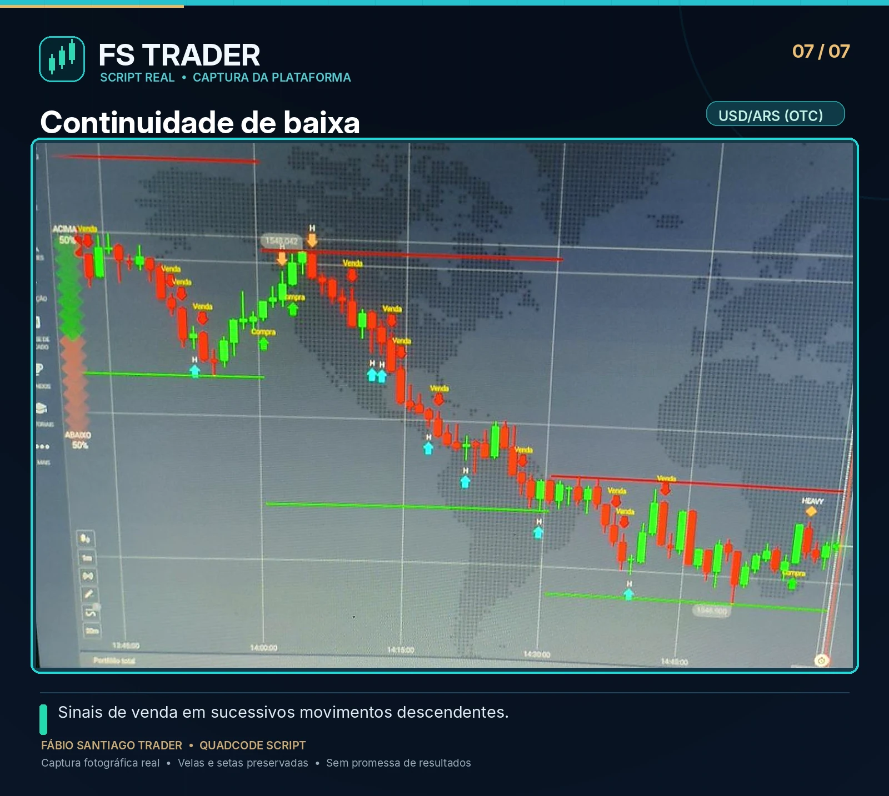

# 📊 Projeto FS Trader Scripts

**Indicadores de análise técnica em Quadcode Script (QCS)**  
**Desenvolvedor: Fábio Santiago Trader**

Um espaço dedicado ao desenvolvimento, estudo e evolução de indicadores gráficos para plataformas de negociação compatíveis com **Quadcode Script**, linguagem baseada em Lua.

O **FS Trader** reúne pesquisas sobre leitura de preço, suporte e resistência, força e exaustão das velas, zonas de consolidação e critérios de proteção. O foco é criar ferramentas que auxiliem a interpretação do mercado com clareza, disciplina e gestão de risco.

> **Nossa filosofia:** o indicador é uma ferramenta de leitura do gráfico, não uma promessa de acerto nem um substituto para a análise do trader.

## 📸 FS Trader em ação | Capturas reais

Abaixo estão **sete artes com capturas reais da plataforma Exnova**, com as velas, marcações H/HEAVY, setas e níveis originais preservados. Os enquadramentos foram tratados apenas para melhorar a apresentação visual. Clique em cada arte para ampliá-la.

| Tendência e reversão | AUD/CAD: do topo ao suporte |
|:---:|:---:|
|  |  |
| **AUD/CAD: movimentos de ida e volta** | **FR 40: tendência e transição** |
|  |  |
| **SOL/USD: zonas e oscilações** | **US 500: fluxo de alta e consolidação** |
|  |  |
| **USD/ARS: continuidade de baixa** | **Galeria de imagens** |
|  | [Abrir a pasta de artes e a capa](artes/) |

> **Transparência:** estas imagens ilustram o funcionamento visual do indicador em momentos específicos. Não constituem backtest de rentabilidade nem garantia de acerto. Alguns sinais podem perder validade durante a formação das velas.

## 🧩 Scripts disponíveis

| Arquivo | Finalidade |
| --- | --- |
| [F20.txt](F20.txt) | **F20**: versão dos alunos, com H, HEAVY e barras M15. |
| [F20_BARRAS_M30.txt](F20_BARRAS_M30.txt) | **F20 BARRAS M30**: versão adicional com M30 visível e proteção complementar M15 oculta. |
| [F21_BARRAS_M15.txt](F21_BARRAS_M15.txt) | **F21 BARRAS M15**: versão pessoal, com proteção M15 ativa e barras ocultas por padrão. |
| [F21_BARRAS_M30.txt](F21_BARRAS_M30.txt) | **F21 BARRAS M30**: M30 visível com proteção seletiva M15 oculta, mantendo H e HEAVY. |
| [F22_REVERSAO.txt](F22_REVERSAO.txt) | **F22 REVERSÃO**: RSI/REV com proteção seletiva M15 oculta e barras M30 visíveis. |

**Desenvolvedor:** Dev. Fábio Santiago | 99 99195-0983

## 🔎 Linhas de estudo

- **Price Action:** leitura de velas, força, continuidade, pausas e exaustão.
- **Suportes e resistências:** referências de períodos maiores e comportamento nas bordas.
- **Proteção e seletividade:** reduzir insistências e sinais em condições desfavoráveis, sem confundir redução de sinais com maior precisão.
- **Volatilidade intravela:** investigar velocidade, amplitude, reversões e agitação do preço com dados históricos e observações ao vivo.

## 🛠️ Tecnologia

- **Linguagem:** Quadcode Script (QCS), baseada em Lua.
- **Formato:** scripts em `.txt` para estudo, edição e importação em ambientes que suportem QCS.
- **Documentação técnica:** [Quadcode Script](https://quadcode-tech.github.io/quadcodescript-docs/).

A compatibilidade e o comportamento de cada versão dependem do editor, da implementação de QCS e dos dados da plataforma utilizada. Faça a validação primeiro em ambiente demonstrativo.

## ⚠️ Aviso de risco

Estes scripts são ferramentas de **estudo e análise técnica**. Não executam automaticamente operações por conta própria, não constituem uma sala de sinais, recomendação financeira ou garantia de resultados. Negociações financeiras envolvem risco de perda, inclusive integral do capital utilizado.

## 👨‍💻 Sobre o desenvolvedor

**Fábio Santiago Trader**  
Criador do **Projeto FS Trader Scripts**.

Desenvolvimento orientado à observação real do gráfico, experimentação, revisão de regras e educação de traders iniciantes. Cada versão preserva um estágio de pesquisa: o objetivo é aprender com o comportamento do preço e tornar os indicadores mais claros e responsáveis.

---

**⭐ Achou este projeto útil ou quer acompanhar sua evolução? Deixe uma estrela no repositório!** Seu apoio ajuda a dar visibilidade à pesquisa e ao trabalho de desenvolvimento.

*Projeto independente, sem afiliação oficial com a Quadcode ou com plataformas de negociação.*
